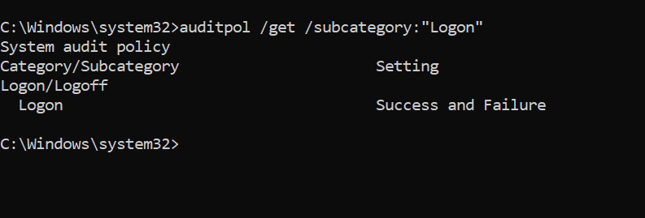
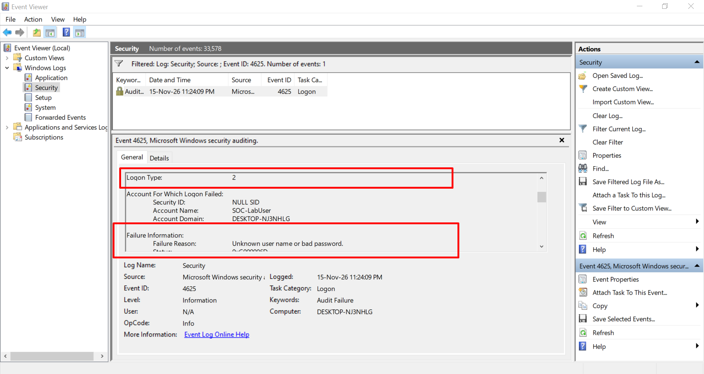
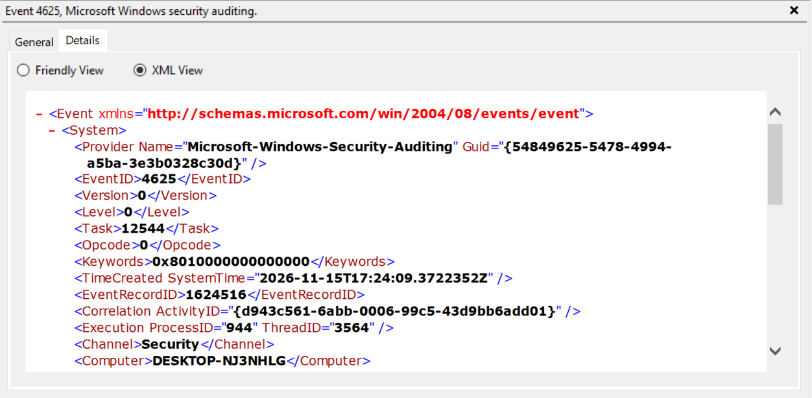
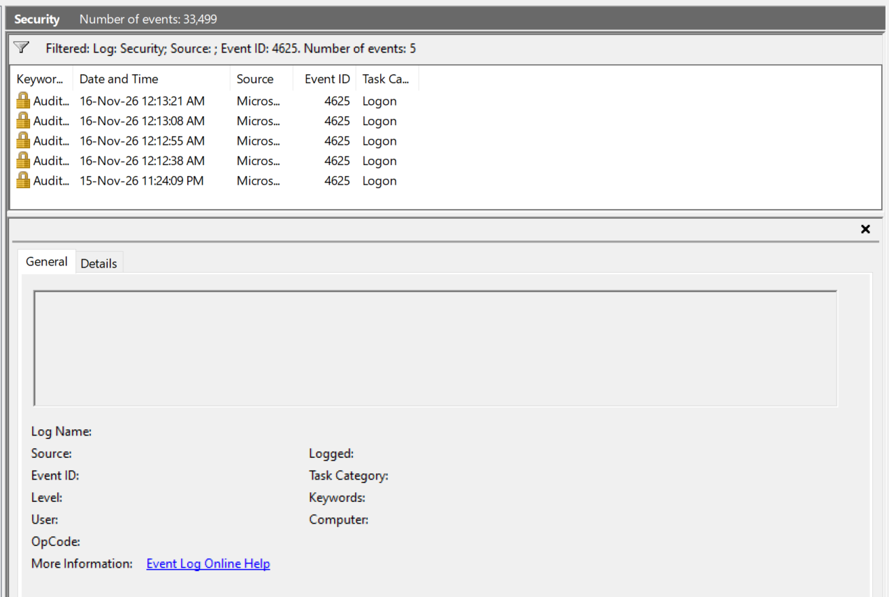
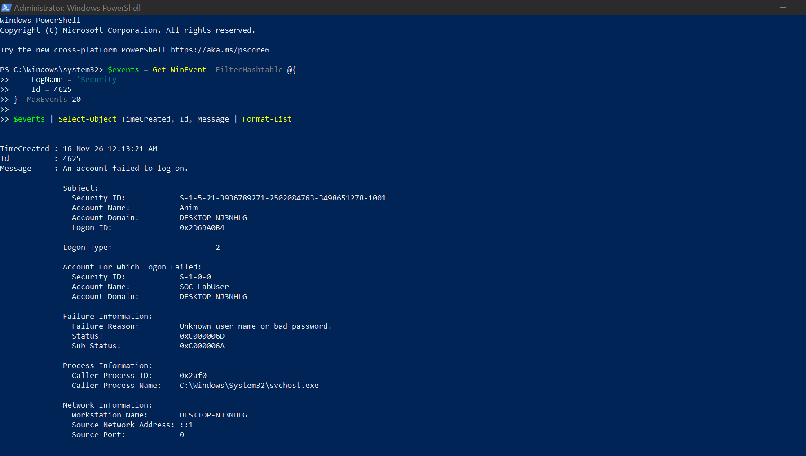
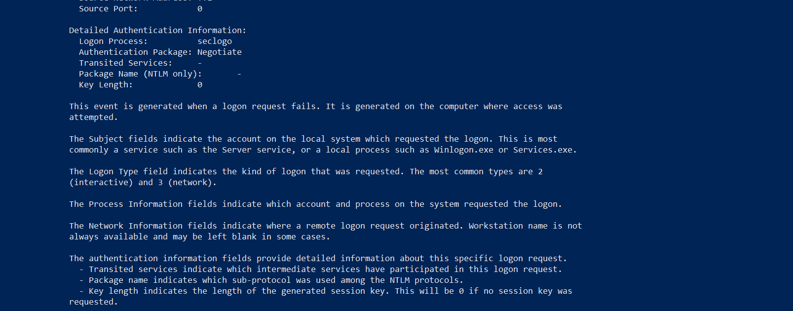
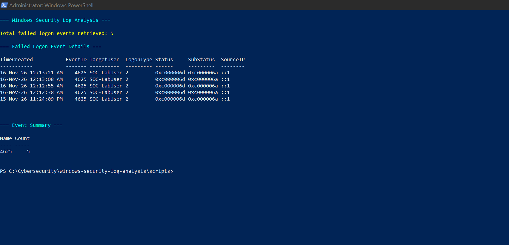

# Windows Security Log Analysis & Brute-Force Investigation

A hands-on cybersecurity lab project focused on Windows Security Event Log analysis, failed authentication investigation, and basic PowerShell automation.

## Project Overview

This project demonstrates how Windows records failed authentication attempts and how a security analyst can investigate these events using Windows Event Viewer and PowerShell.

A controlled series of five failed login attempts was generated against a dedicated local test account (`SOC-LabUser`). The resulting security events were collected, examined, and analyzed.

## Objectives

- Understand Windows Security Auditing.
- Identify failed authentication events using Event ID 4625.
- Interpret relevant Windows security event fields.
- Investigate repeated failed login attempts.
- Retrieve and analyze security logs using PowerShell.
- Document findings in a SOC-style investigation report.

## Lab Environment

| Component | Details |
|---|---|
| Operating System | Windows 10 Pro |
| Log Source | Windows Security Log |
| Log Analysis | Windows Event Viewer |
| Scripting | Windows PowerShell |
| Test Account | SOC-LabUser |
| Event ID | 4625 |

## Tools & Technologies

- Windows 10 Pro
- Windows Event Viewer
- Windows Security Auditing
- PowerShell
- Windows Event ID 4625

## Investigation Methodology

1. Verified Windows Logon auditing configuration.
2. Generated five controlled failed login attempts against a dedicated local test account.
3. Located and filtered Event ID 4625 in Windows Security Logs.
4. Examined event properties and XML details.
5. Analyzed authentication-related fields, including status codes, logon type, and source address.
6. Developed a PowerShell script to retrieve, extract, and summarize failed logon events.

## Key Findings

Five failed authentication events were retrieved during the investigation.

| Event Field | Observed Value | Interpretation |
|---|---|---|
| Event ID | 4625 | Failed logon |
| Target Account | SOC-LabUser | Dedicated lab account |
| Logon Type | 2 | Interactive logon |
| Status | 0xC000006D | General logon failure |
| SubStatus | 0xC000006A | Incorrect password |
| Source Address | ::1 | IPv6 loopback / local machine |
| Total Events | 5 | Failed logon events retrieved |

## PowerShell Analysis

A PowerShell script was developed to:

- Retrieve the latest 20 Event ID 4625 records.
- Extract relevant event fields from XML data.
- Display timestamps, target accounts, logon types, status codes, and source addresses.
- Summarize the retrieved events by Event ID.

**Script:** [`analyze-security-logs.ps1`](Scripts/analyze-security-logs.ps1)

To execute the script, open PowerShell as Administrator, navigate to the project directory, and run:

```powershell
Set-ExecutionPolicy -Scope Process -ExecutionPolicy Bypass
.\Scripts\analyze-security-logs.ps1
```

The execution-policy change applies only to the current PowerShell session.

## Screenshots & Evidence

The following screenshots document the investigation process:

### 1. Audit Policy Configuration



### 2. Failed Login Event — General Details



### 3. Failed Login Event — XML Details



### 4. Repeated Failed Login Attempts



### 5. PowerShell Security Log Analysis

The PowerShell investigation output is documented across three screenshots:






### 6. PowerShell Script Execution



## Security Analysis & Conclusion

Event ID 4625 records unsuccessful logon attempts. The observed SubStatus value `0xC000006A` indicates an incorrect password.

Logon Type 2 and source address `::1` indicate that the observed attempts originated from local interactive logon activity rather than a remote network source.

Repeated failed authentication events can be associated with password-guessing or brute-force behavior. However, the five attempts in this project were deliberately generated for testing purposes. They do not establish an actual cyberattack.

This exercise provided practical experience with Windows security auditing, authentication-event investigation, PowerShell-based log analysis, and basic security incident documentation.

## Project Structure

```text
windows-security-log-analysis/
│
├── README.md
│
├── Screenshots/
│   ├── 01-audit-policy.png
│   ├── 02-event-4625-general.png
│   ├── 03-event-4625-xml.png
│   ├── 04-repeated-failed-logins.png
│   ├── 05-powershell-analysis-01.png
│   ├── 05-powershell-analysis-02.png
│   ├── 05-powershell-analysis-03.png
│   └── 06-script-execution.png
│
├── Scripts/
│   └── analyze-security-logs.ps1
│
└── Report/
    └── investigation-report.md
```

## Disclaimer

This project was conducted in a personal Windows lab environment using controlled authentication-failure simulations. No unauthorized systems or accounts were targeted.

## Investigation Report

[Read the full investigation report](Report/investigation-report.md)
